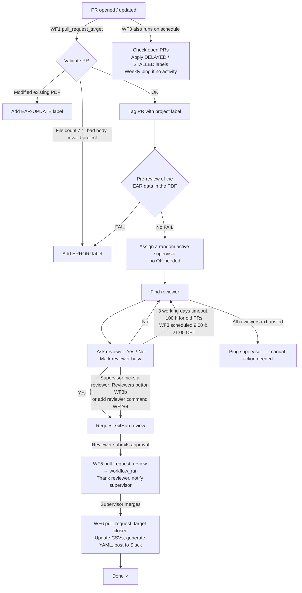

# EAR bot

Automates peer review of ERGA Assembly Reports (EARs) via GitHub Actions. The bot selects supervisors and reviewers, tracks their workload, and updates data files automatically. For EAR creation and submission instructions, see the [Wiki](https://github.com/ERGA-consortium/EARs/wiki).

---

## Lifecycle diagram



> **Concurrency:** WF1, WF2+4, and WF6 share the group `ear-bot-pr-{PR_NUMBER}` with `cancel-in-progress: false`, so runs for the same PR are serialised. WF5 uses a two-step artifact pattern: the first step (`pull_request_review` event) saves PR data to an artifact without secrets; the second step (`workflow_run` event) reads the artifact and runs the bot with the GitHub App token.

---

## Workflows

| # | File | Trigger | Bot flag | Action |
|---|------|---------|----------|--------|
| 1 | `1_ear_bot_pr.yml` | `pull_request_target` [opened, reopened, synchronize, edited] on `Assembly_Reports/**/*.pdf` | `--supervisor` | Validate PR, apply label, pre-review the PDF, assign a supervisor, ask a reviewer |
| 2+4 | `2+4_ear_bot_comment.yml` | `issue_comment` [created] (PR only, with project label) | `--comment` | Handle Yes / No / add reviewer / CLEAR; find next reviewer |
| 3 | `3_ear_bot_reviewer.yml` | `schedule` (09:00 & 21:00 CET) + `workflow_dispatch` | `--search` | Timeout check, next reviewer, DELAYED/STALLED labels |
| 3b | `3_ear_bot_manual_reviewer.yml` | `pull_request_target` [review_requested] by a person (not the bot), with project label | `--manual-review` | Adopt a manually requested reviewer: free everyone the bot asked, mark the new reviewer busy, tell the pending one no reply is needed |
| 5a | `5_ear_bot_approved.yml` | `pull_request_review` [submitted, approved] | — | Save PR_NUMBER + REVIEWER to artifact |
| 5b | `5_ear_bot_approved_comment.yml` | `workflow_run` on WF5a [completed] | `--approve` | Read artifact, thank reviewer, notify supervisor |
| 6 | `6_ear_bot_merge.yml` | `pull_request_target` [closed] | `--merge` | Update CSVs, generate YAML, post Slack (ERGA-BGE only) |

---

## Bot commands

| Who | When | Command | Effect |
|-----|------|---------|--------|
| Any supervisor | PR open | `@erga-ear-bot add reviewer @user` | Requests a review from @user and adopts them like the Reviewers button: frees everyone the bot asked, marks @user busy, and makes the requester the supervisor if the PR has none. Does nothing if a reviewer is already appointed |
| Reviewer | After bot asks them | `Yes` | Reviewer is formally requested; all previously-pinged-but-declined reviewers are unbusy'd |
| Reviewer | After bot asks them | `No` | Bot moves to the next candidate |
| Supervisor | After PR is **closed** | `@erga-ear-bot CLEAR` | Clears all labels and gives everyone the bot asked `Working PRs − 1` |

No OK is needed from supervisors any more: the bot assigns one, and another supervisor takes over by changing the assignee. All commands are case-insensitive. Only the first non-quoted line of the comment is checked for Yes/No.

---

## Labels

| Label | Meaning | Set by | Cleared by |
|-------|---------|--------|------------|
| `ERGA-BGE` | Project type BGE | WF1 | WF6 (on close) or CLEAR command |
| `ERGA-Pilot` | Project type Pilot | WF1 | WF6 (on close) or CLEAR command |
| `ERGA-Community` | Project type Community | WF1 | WF6 (on close) or CLEAR command |
| `ERGA-CBP` | Project type CBP | WF1 | WF6 (on close) or CLEAR command |
| `ERGA-ATLASea` | Project type ATLASea | WF1 | WF6 (on close) or CLEAR command |
| `ERROR!` | Validation problem (bad body, wrong file count, pre-review FAIL, etc.) | WF1 / WF2+4 | WF1 on next valid edit or push |
| `EAR-UPDATE` | PR is modifying an already-approved EAR | WF1 | Manual / WF6 |
| `DELAYED` | Researcher has not commented in ≥ 4 weeks | WF3 | Manual |
| `STALLED` | Nobody has commented in ≥ 4 weeks | WF3 | WF3 when activity resumes |

---

## Reviewer scoring

`rev/get_EAR_reviewer.py` is the single source of truth for selection and scoring; the bot imports its functions and posts its `format_report` table, so the table always names the reviewer the bot asks. The numbers live in the configuration block at the top of that script.

**Eligibility** (`select_best_reviewer`):
- `Active == 'Y'`
- Institution ≠ the submitter's institution (normalised via `normalize_institution`)
- Not the submitter, not the PR's supervisor, and not anyone already asked on this PR

**Score** (`score_breakdown`): the `Calling Score`, plus a bonus for never having reviewed and for the project's institutions (`PROJECT_BONUSES`), minus a penalty for being a supervisor, per working PR, and for a recent review. Ties go to fewest reviews, then oldest last review, then a random pick.

**Updates to `reviewers_list.csv`** (the `record_*` functions):
- Asked to review: `Working PRs + 1` (`record_assignment`)
- Someone takes the PR (Yes, Reviewers button or `add reviewer`): everyone else asked gets `Working PRs − 1`; each one whose request timed out (other than the person taking it) gets `Calling Score + 1` (`record_timeouts`)
- Merged: reviewer `Calling Score − 1`, `Total Reviews + 1`, `Last Review` = merge date, `Working PRs − 1`; everyone at the submitter's institution `Calling Score + 1` (`record_review`)
- CLEAR on a closed PR: everyone asked gets `Working PRs − 1`

Each update reads the file again right before writing and commits against that read; if another run committed in between, it reads and applies the change again. Both CSVs are written with the `csv` module, so values with commas are quoted.

---

## Data files

### `rev/reviewers_list.csv`

| Column | Description |
|--------|-------------|
| `Github ID` | Reviewer's GitHub username (lowercase) |
| `Full Name` | Display name used in comments and EAR_reviews.csv |
| `Institution` | Affiliation; normalised by `normalize_institution` for comparisons |
| `Supervisor` | `Y` if the person can act as supervisor |
| `Total Reviews` | Cumulative number of completed reviews |
| `Last Review` | Date of most recent review (YYYY-MM-DD) or `NA` |
| `Active` | `Y` if currently accepting reviews |
| `Working PRs` | Number of PRs the reviewer is currently assigned to |
| `Calling Score` | Base score used for selection (higher = called more often) |

The bot auto-commits changes to this file after each reviewer assignment and after each merge.

### `rev/EAR_reviews.csv`

Append-only log of completed reviews. One row per merged PR, written by WF6. Columns: PR URL, species, project tag, requester name/affiliation, reviewer name/affiliation, supervisor name/affiliation, interaction count, open date, approval date, other participants, notes.

---

## Configuration & secrets

| Name | Where | Description |
|------|-------|-------------|
| `APP_PRIVATE_KEY` | Repository secret | Private key for GitHub App ID 917566 (`erga-ear-bot`). Used to generate a short-lived token with write access to the repo |
| `SLACK_TOKEN` | Repository secret | Slack Bot OAuth token for posting merge announcements |
| `SLACK_CHANNEL_ID` | Hardcoded in WF6 | `C070UHJ80Q3` (#wp9-assembly-delivery). Change directly in `6_ear_bot_merge.yml` if needed |
| `GITHUB_APP_TOKEN` | Injected at runtime | Generated by `actions/create-github-app-token`; passed via env var to the Python script |

**Python dependencies** (`ear_bot/requirements.txt`): `PyGithub`, `pytz`, `slack_sdk`, `pdfplumber`, `pyyaml`, `requests`

---

## Pre-review

EARs made with `scripts/make_EAR.py` v26.11.10 or later store the report data as JSON in the PDF's XMP metadata. On every push, WF1 reads it with `scripts/EARpdf_to_yaml.py` and posts one comment (`ear_bot/pre_review.py`):

| Section | Check | ❌ critical | ⚠️ warning |
|---------|-------|-------------|------------|
| | Metadata (EAR data readable: format and Report ID) | missing or unreadable; other checks skipped | |
| Report vs PR body check | Species name (ignoring capitals, repeated spaces and `_`/`*` italics around the name) | differs | |
| | ToLID, Project | | differs (both values shown) |
| Contact map info | Pretext link (one row, all haps) | broken (HTTP 404/410) or not a web link | NA |
| Metrics | Missing fields (NA cells in the metrics table) | | any, listed |
| | K-mer spectra plots | NA | |
| Contamination screening | FCS-GX, Blobplot (one row each, all haps) | both NA for every hap | NA for a hap, or FCS-GX flagged sequences |
| Additional info | Dataset info | no data types listed | a data type without an amount |
| | Pipelines info, Curation notes | | NA |
| | Warning flags (make_EAR flags) | | any, counted and listed |

A row for several haps shows the worst of them. A Pretext link that can't be confirmed (timeout, access refused, other HTTP error, a web page instead of the file) gets ℹ️ "check by hand". Any critical item adds `ERROR!` and stops before a supervisor is assigned; the comment names the items to fix.

**Old and new PRs:** only PRs opened on or after `NEW_SYSTEM_FROM` (in `ear_bot_reviewer.py`) get the pre-review and the 3-working-day reply time. Older PRs keep the old system: no pre-review, 100 working hours. Set the date on the release day, once the Galaxy tool ships the new make_EAR, otherwise EARs made in Galaxy fail. While it is unset, every PR is old.

At merge, WF6 makes the YAML with `scripts/EARpdf_to_yaml.py`, or `scripts/legacy/EARpdf_to_yaml.py` for PDFs without EAR data, and appends an `EAR review` section (PR, submitter, reviewer, supervisor, affiliations, dates).

---

## Troubleshooting

**Bot not responding to a new PR**
Check that the PDF is under `Assembly_Reports/` and that only one file was changed. WF1 only fires on `Assembly_Reports/**/*.pdf` paths.

**`ERROR!` label won't clear**
WF1 clears `ERROR!` automatically when the PR body is edited (if the body is now valid) or when a new commit is pushed (if the file-count issue is resolved). If neither applies, a supervisor can remove the label manually.

**Reviewer asked but no response / deadline passed**
WF3 runs twice daily and calls `find_reviewer` with a deadline check. If 3 working days (100 working hours for PRs opened before `NEW_SYSTEM_FROM`) have elapsed since the last "do you agree to review" comment, it moves to the next candidate automatically. No manual intervention needed unless all reviewers are exhausted.

**All reviewers exhausted**
The bot posts an error comment and adds `ERROR!`. The supervisor must manually assign a reviewer via GitHub's review-request UI, then clear `ERROR!` manually.

**Workflow concurrency / queued runs**
All PR-specific workflows share the concurrency group `ear-bot-pr-{PR_NUMBER}` with `cancel-in-progress: false`. Runs are queued, not cancelled. If a run seems stuck, check the Actions tab for a queued job on the same PR.

**Slack post not appearing**
WF6 only posts to Slack for `ERGA-BGE` PRs. Verify `SLACK_TOKEN` and `SLACK_CHANNEL_ID` are set and correct. The channel ID is hardcoded; the token must be a repository secret named `SLACK_TOKEN`.

**`DELAYED` or `STALLED` label appeared**
`DELAYED` means the submitter hasn't commented in 4 weeks. `STALLED` means no-one has. Both are set by WF3. `STALLED` is automatically removed when any non-bot comment appears. `DELAYED` must be removed manually after activity resumes.

---

## Developer setup

```bash
git clone https://github.com/ERGA-consortium/EARs.git
cd EARs
uv pip install -r ear_bot/requirements.txt
```

**Local reviewer selection** (no GitHub App token needed):

```bash
python rev/get_EAR_reviewer.py -i "CNAG" -t ERGA-BGE
python rev/get_EAR_reviewer.py -i "Sanger" --supervisor --user myusername
```

**Full bot logic** requires a `GITHUB_APP_TOKEN` with write access to the repository. The simplest way to test end-to-end is via `workflow_dispatch` on WF3 in a fork with the App installed.
